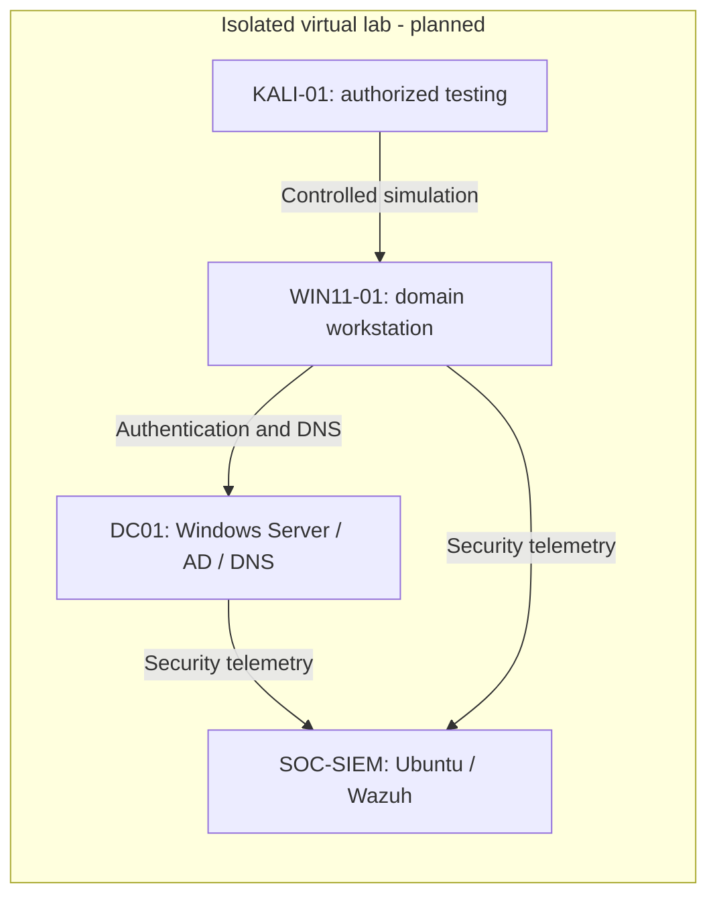

# Planned architecture

Design only: no VMs currently verified. IPs, subnet, gateway, DNS domain, hypervisor, and adapter settings are TBD.

WIN11-02 is an optional later workstation. Cloud exercises are later extensions subject to budget and licensing checks.

Use an isolated virtual network with temporary internet access only when required. No public inbound exposure. Document and explain every IP, DNS setting, gateway, adapter, and firewall exception before deployment.

| Host | IP | DNS | Adapter | Verification |
| --- | --- | --- | --- | --- |
| DC01 | TBD | TBD | TBD | Pending |
| WIN11-01 | TBD | TBD | TBD | Pending |
| SOC-SIEM | TBD | TBD | TBD | Pending |
| KALI-01 | TBD | TBD | TBD | Pending |
