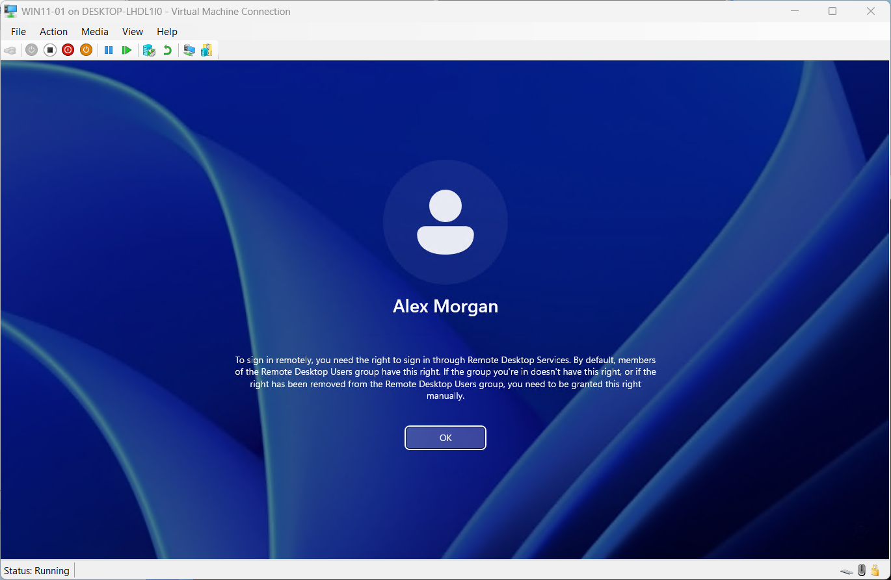

# Progress tracker

| Phase | Deliverable | Status |
| --- | --- | --- |
| 0 - Planning and virtualization | Host assessment, network design, recovery plan | Complete |
| 1 - Windows Server and AD | Working domain, DNS, users, groups, GPO | Complete |
| 2 - Workstation | Verified domain join and policy application | Complete |
| 3 - Security logging | Windows, Sysmon, PowerShell telemetry | Complete — local baseline |
| 4 - Wazuh | Centralized logs and agent connectivity | Complete — baseline verified |
| 5 - SOC investigations | Evidence-backed incident reports | Complete |
| 6 - Detection engineering | Tested rules and ATT&CK mappings | Complete — lab baseline verified |
| 7 - PowerShell | Documented, verified administration scripts | In progress |
| 8 - Entra ID | Cloud identity security exercises | Not started |
| 9 - Defender and Sentinel | Hunting and investigation exercises | Not started |
| 10 - Portfolio | Curated case studies and interview practice | Not started |

### Phase 0 checkpoint — VM storage configured

- Host: Windows 11 Pro; Ryzen 7 8845HS; 27.8 GB usable RAM.
- Reported free storage: C: 259.16 GB; D: 99.8 GB.
- Hyper-V feature: Enabled.
- Running hypervisor detected: True.
- SOC-LAB: Private switch, verified with Get-VMSwitch.
- Hyper-V default configuration path: C:\SOC-Lab\VirtualMachines
- Hyper-V default virtual disk path: C:\SOC-Lab\VirtualHardDisks
- Installation media folder: C:\SOC-Lab\ISO
- Verified default paths with Get-VMHost.
- Get-VM returned no registered virtual machines.
- Default Switch: Internal; unchanged.
- No virtual machines created yet.
- Phase 0 remains completed.

### DC01 domain promotion — baseline verified

- Created forest/domain: ad.shahidtech.test.
- NetBIOS name: SHAHIDTECH.
- Forest and domain functional levels configured as Windows Server 2025.
- NTDS and DNS services verified Running.
- LDAP domain-controller SRV record resolves to dc01.ad.shahidtech.test:389.
- DC01 hostname resolves to 10.10.10.10.
- SYSVOL and NETLOGON shares verified present.
- dcdiag passed Connectivity, Advertising, SysVolCheck, and NetLogons.
- DNS delegation warning accepted because no parent DNS zone exists in this isolated lab.
- Pre-AD checkpoint exists; no independent backup available.
- Evaluation activation and updates remain pending.
- Phase 1 remains in progress.

### AD organization and first employee — verified

- Created ShahidTech OU at the domain root.
- Created Employees and workstations child OUs.
- Verified accidental-deletion protection on all three OUs.
- Created fictional employee Alex Morgan in Employees.
- Sign-in name: alex.morgan@ad.shahidtech.test.
- Account enabled; password change required at next sign-in.
- Verified group membership: Domain Users only.
- Employee workstation sign-in remains untested.
- DC01 remains in the Domain Controllers OU.

### Employee security group — verified

- Created GG-ShahidTech-Employees as a Global security group.
- Added alex.morgan.
- Verified Alex's memberships: Domain Users and GG-ShahidTech-Employees.
- No resource permissions assigned to the employee group yet.
- Reviewed OU organization, group-based access, and least privilege.

### Employee share — configured; client testing pending

- Created DL-EmployeeShare-Read as a Domain Local security group.
- Nested GG-ShahidTech-Employees inside it.
- Verified recursive membership resolves to alex.morgan.
- Created C:\LabShares\EmployeeShare on DC01 for this lab exercise.
- Disabled NTFS inheritance while preserving existing entries.
- Removed BUILTIN\Users permission entries.
- Granted DL-EmployeeShare-Read inheritable Read & execute.
- Published EmployeeShare with share-level Read for the access group.
- Administrators retain Full Control at share and NTFS levels.
- Created welcome.txt and verified inherited read permissions.
- Pending: verify Alex can read but cannot create, modify, or delete files.
- Lab limitation: file sharing is hosted on the domain controller.

### WIN11-01 — domain sign-in and Enhanced Session verified

- Installed Windows 11 Pro; Windows computer name is WIN11-01.
- Configured 10.10.10.20/24 with DNS 10.10.10.10 and no gateway.
- Verified domain-controller DNS discovery from the workstation.
- Joined ad.shahidtech.test; verified PartOfDomain is True.
- Signed in as SHAHIDTECH\alex.morgan; logon server was DC01.
- Enhanced Session initially denied Alex remote logon.
- Added Alex to WIN11-01's local Remote Desktop Users group.
- Confirmed Enhanced Session works without granting Alex administrator privileges.
- Employee-share read and denied-write tests remain pending.

#### Troubleshooting evidence

### Employee share — client access validated

Tested from WIN11-01 as SHAHIDTECH\alex.morgan:

| Operation | Observed result |
|---|---|
| Read welcome.txt | Allowed |
| Create alex-write-test.txt | Access denied |
| Append to welcome.txt | Access denied |
| Delete delete-test.txt | Access denied; file remained |
| Re-read welcome.txt | Original two lines unchanged |

Access follows Alex → GG-ShahidTech-Employees →
DL-EmployeeShare-Read → resource permissions.

These SMB tests validate combined share and NTFS restrictions;
they do not isolate either permission layer.

#### Evidence

- [Successful read](../evidence/phase-02/06-employee-share-read-success.png)
- [Creation denied](../evidence/phase-02/07-employee-share-create-denied.png)
- [Modification denied](../evidence/phase-02/08-employee-share-modify-denied.png)
- [Deletion denied](../evidence/phase-02/09-employee-share-delete-denied.png)

### Workstation Group Policy — delivery verified

- Moved WIN11-01 from Computers into ShahidTech/workstations.
- Created ShahidTech-Workstation-Baseline.
- Configured the computer sign-in notice title and text.
- Linked the GPO to workstations; link enabled, not enforced.
- Verified gpresult lists the GPO as applied from DC01.
- Verified legalnoticecaption and legalnoticetext match the policy.
- Confirmed the notice appears before sign-in.
- This notice demonstrates policy delivery; it does not enforce access restrictions.

#### Evidence

- [Computer OU placement](../evidence/phase-02/10-workstation-ou-placement.png)
- [GPO settings](../evidence/phase-02/11-gpo-signin-notice-settings.png)
- [Applied policy](../evidence/phase-02/12-gpo-applied-result.png)
- [Visible notice](../evidence/phase-02/13-gpo-signin-notice-visible.png)

### Workstation domain trust — verified

- Test-ComputerSecureChannel -Verbose returned True on WIN11-01.
- Confirmed the secure channel to ad.shahidtech.test is healthy.
- RSOP identified ShahidTech-Workstation-Baseline as the source of the sign-in notice settings.
- Reviewed GPO linking versus the separate Enforced option.

[Secure-channel verification](../evidence/phase-02/14-domain-secure-channel.png)

### Authentication telemetry and time-zone correlation — verified

- WIN11-01 effective Logon auditing: Success and Failure.
- DC01 effective Kerberos Authentication Service, Kerberos Service
  Ticket Operations, and Credential Validation auditing: Success.
- Local policy GUI showed Not Configured; this did not mean
  effective auditing was disabled.
- Observed event 4624 for SYSTEM with Logon Type 5 (service).
- Observed event 4624 for alex.morgan with Logon Type 10
  (RemoteInteractive), consistent with Enhanced Session activity.
- Negotiate and Key Length 0 alone did not establish the protocol.
- DC01 recorded successful Kerberos TGT requests (4768) for Alex
  from 10.10.10.20, with Result Code 0x0.
- Initial event displays differed because DC01 used Pacific Time
  and WIN11-01 used Eastern Time.
- After UTC normalization, a TGT request and workstation logon
  shared timestamp 2026-11-15T21:37:14Z.
- Matching account, client IP, and time support correlation;
  a timestamp match alone is not a unique session identifier.
- Changed DC01 to Eastern Time and verified the existing latest
  TGT event displays 4:37:16 PM instead of 1:37:16 PM.
- Phase 3 remains in progress.

### Controlled failed logon — verified

- Test: one deliberate incorrect-password runas attempt as alex.morgan.
- Test started: 2026-11-15T20:30:12-05:00.
- Event 4625 recorded on WIN11-01 at 20:30:23 Eastern.
- Logon Type 2; source ::1; logon process seclogo.
- Status 0xC000006D; SubStatus 0xC000006A (incorrect password).
- Result is consistent with the authorized test, not evidence of brute force.
- Underlying authentication protocol remains unconfirmed.

[Controlled attempt](../evidence/phase-03/07-controlled-runas-failure.png)
[Failed-logon event](../evidence/phase-03/08-alex-failed-logon-4625.png) 

### Centralized workstation logon auditing — verified

- Created ShahidTech-Workstation-Auditing.
- Defined Audit Logon: Success and Failure.
- Enabled audit subcategory settings to override legacy categories.
- Linked the GPO to workstations; enabled, not enforced.
- Refreshed computer policy on WIN11-01 successfully.
- Fresh gpresult output lists the auditing GPO as applied from DC01.
- auditpol confirms effective Logon auditing: Success and Failure.
- SCENoApplyLegacyAuditPolicy verified as 1.
- Logon auditing was already enabled before deployment; this
  milestone explicitly defines and delivers the intended policy centrally.

[Audit GPO settings](../evidence/phase-03/09-workstation-audit-gpo-settings.png)
[Client verification](../evidence/phase-03/10-workstation-audit-policy-applied.png)

### Process creation and command-line logging — verified

- Initial effective Process Creation policy: No Auditing.
- Enabled Audit Process Creation: Success in the workstation auditing GPO.
- Refreshed WIN11-01 and verified effective auditing: Success.
- Observed event 4688 for Alex launching cmd.exe; command line was initially blank.
- Enabled Include command line in process creation events centrally.
- Verified client ProcessCreationIncludeCmdLine_Enabled value: 1.
- Generated a harmless cmd.exe /c echo ShahidTech-4688-Test invocation.
- Event 4688 recorded Alex, explorer.exe as parent, Medium integrity,
  and the expected command line.
- Command-line logging captures launch arguments, not every command
  subsequently entered into an interactive shell.

[Before configuration](../evidence/phase-03/11-process-creation-audit-before.png)
[GPO setting](../evidence/phase-03/12-process-creation-gpo-setting.png)
[Effective audit policy](../evidence/phase-03/13-process-creation-audit-applied.png)
[Initial process event](../evidence/phase-03/14-cmd-process-created-4688.png)
[Command-line setting applied](../evidence/phase-03/15-commandline-logging-enabled.png)
[Command line recorded](../evidence/phase-03/16-process-commandline-4688.png)

### Windows PowerShell Script Block Logging — verified

- Windows PowerShell Operational channel enabled on WIN11-01.
- ShahidTech-Workstation-Auditing defines EnableScriptBlockLogging
  as DWORD 1.
- Refreshed client policy and verified the client value is 1.
- Executed Write-Output "ShahidTech-4104-Test" as Alex.
- Event 4104 recorded the exact script text at
  2026-11-15 22:37:05 Eastern.
- Event UserId matches Alex's previously verified SID.
- ScriptBlock ID: 790ac94d-51b6-424f-bef1-ca5a92ffef58.
- Script Block Invocation Logging was not verified as enabled.
- Event 4104 establishes captured script content, not successful
  completion or command output.

[Client configuration](../evidence/phase-03/17-powershell-logging-before.png)
[Script-block event](../evidence/phase-03/18-powershell-scriptblock-4104.png)

### Windows PowerShell Module Logging — verified

- Enabled Module Logging in ShahidTech-Workstation-Auditing.
- Configured module-name wildcard *.
- Refreshed WIN11-01 policy and verified EnableModuleLogging = 1
  and ModuleNames entry * = *.
- Opened a new Windows PowerShell session as Alex.
- Executed Write-Output "ShahidTech-4103-Test".
- Event 4103 recorded the cmdlet invocation and parameter binding.
- Related Out-Default event contained the same marker.
- Both events shared user, timestamp, Host ID, Runspace ID,
  and Pipeline ID 8.
- GUI troubleshooting: the leftmost grid asterisk indicated a
  new row; the module wildcard had to be entered in the Value cell.

[Client configuration](../evidence/phase-03/19-module-logging-policy-applied.png)
[Module execution evidence](../evidence/phase-03/20-powershell-module-event-4103.png)

### Windows PowerShell transcription — content verified

- Workstation auditing GPO enables transcription.
- Verified EnableTranscripting = 1 on WIN11-01.
- No custom output directory configured.
- Observed a transcript under Alex's Documents/20261115 folder.
- Transcript identifies SHAHIDTECH\alex.morgan, WIN11-01,
  Windows PowerShell 5.1, and process ID 13900.
- Captured whoami and its output.
- Captured Write-Output "ShahidTech-Transcript-Test" and its output.
- Raw transcripts remain outside Git; reviewed screenshot used as evidence.
- Limitation: user-local storage is not centrally protected or tamper-resistant.
- Clean transcript closure was not established by the captured excerpt.

[Client policy](../evidence/phase-03/21-transcription-policy-applied.png)
[Command and output](../evidence/phase-03/22-transcription-command-and-output.png)

### Script outcome verification — completed

- Created ShahidTech-Outcome-Test.txt in Alex's temporary folder.
- Test-Path returned True.
- Get-Content returned "Authorized lab outcome test."
- Opened the file separately in Notepad and confirmed matching content.
- Transcript recorded the commands and verification output.
- Lesson: recorded script content alone does not prove its intended effect.

[Recorded checks](../evidence/phase-03/23-script-outcome-verification.png)
[File inspected separately](../evidence/phase-03/24-file-outcome-independent-check.png)

### Security log capacity — verified after restart

- Initial Security log maximum: 20971520 bytes (20 MiB).
- Retention mode: Circular.
- Configured 131072 KB (128 MiB) in the workstation auditing GPO.
- gpupdate succeeded, but the active log initially remained at 20 MiB.
- Client policy report confirmed the intended value and winning GPO.
- After a normal workstation restart, Get-WinEvent reported
  134217728 bytes (128 MiB), still Circular.
- No log clearing or manual local size override was performed.
- Larger capacity provides more buffer, not a guaranteed retention period.
- Troubleshooting lesson: policy delivery and active service
  configuration require separate verification.

[Initial configuration](../evidence/phase-03/25-security-log-retention-before.png)
[Policy delivery](../evidence/phase-03/26-security-log-policy-delivered.png)
[Active capacity after restart](../evidence/phase-03/27-security-log-capacity-after-restart.png)

### Observed log history and PowerShell capacity — verified

- WIN11-01 Security log observed range:
  2026-11-15 01:03:37 to 2026-11-16 19:02:00 Eastern.
- Observed span: 41.97 hours; not a guaranteed retention period
  or proof of uninterrupted collection.
- PowerShell Operational log initially had a 15 MiB limit.
- Increased its limit locally to 67108864 bytes (64 MiB).
- Verified Circular retention remained unchanged.
- PowerShell channel capacity is locally configured;
  Security log capacity is managed through the domain GPO.
- Centralized collection remains pending.

[Observed Security history](../evidence/phase-03/28-security-log-observed-timespan.png)
[PowerShell log capacity](../evidence/phase-03/29-powershell-log-capacity.png)

### Defender intelligence refresh and network restoration — verified

- Defender antivirus and real-time protection were enabled.
- Initial signature timestamp: 2025-09-16.
- Temporarily connected WIN11-01 to Default Switch with DHCP
  and automatic DNS for updates.
- Update-MpSignature returned RPC error 0x800706be, recorded in
  the session's pasted command output; no error screenshot was captured.
- Subsequent status showed signature version 1.463.334.0,
  updated 2026-11-16, signature age 0, and real-time protection enabled.
- Fresh signatures were verified; the exact update mechanism
  responsible was not established.
- Reconnected WIN11-01 to SOC-LAB and restored:
  10.10.10.20/24, DNS 10.10.10.10, no default gateway.
- Network profile recognized ad.shahidtech.test.

[Initial Defender status](../evidence/phase-03/30-defender-status-before.png)
[Verified Defender signature status](../evidence/phase-03/31-defender-signature-status.png)
[Lab network restored](../evidence/phase-03/32-lab-network-restored.png)

### Defender operational telemetry — baseline verified

- Defender Operational channel enabled, with a 16 MiB limit
  and Circular retention.
- Inspected five recent events; all were configuration-change
  event 5007, not malware detections.
- Observed initialization, service-state, notification-related,
  and MAPS failure timestamp changes.
- Current Defender service, antivirus, and real-time protection
  status all verified True.
- WIN11-01 remains at 10.10.10.20, DNS 10.10.10.10,
  with no default gateway.
- Isolation is a plausible explanation for cloud-connectivity
  failures; their exact cause remains unconfirmed.
- Information-level severity alone does not establish benign activity.

[Channel configuration](../evidence/phase-03/33-defender-channel-status.png)
[Configuration events](../evidence/phase-03/34-defender-configuration-events.png)
[Protection and isolation](../evidence/phase-03/35-defender-protection-and-isolation.png)

### Sysmon process telemetry — verified

- Enabled the built-in Sysmon optional feature on WIN11-01.
- Installed its service using C:\LabTools\Sysmon\sysmon-lab.xml.
- Verified Sysmon service Running and Operational channel enabled.
- Configuration schema: 4.91; SHA256 hashing enabled.
- ProcessCreate uses an empty exclude filter.
- Generated a harmless cmd.exe marker command as Alex.
- Correlated Sysmon event 1 with Security event 4688 using
  host, timestamp, executable, command line, and process IDs.
- Child PID: decimal 3796 = hexadecimal 0xed4.
- Parent PID: decimal 2352 = hexadecimal 0x930.
- Sysmon additionally supplied process GUIDs and an executable hash.
- Network-connection collection remains disabled.

[Sysmon installation](../evidence/phase-03/42-sysmon-installation.png)
[Loaded configuration](../evidence/phase-03/43-sysmon-loaded-configuration.png)
[Sysmon process event](../evidence/phase-03/44-sysmon-process-create.png)
[Cross-log correlation](../evidence/phase-03/45-security-process-event-comparison.png)

### Sysmon process-to-network correlation — verified

- Added a NetworkConnect include rule for powershell.exe.
- Verified the running Sysmon configuration loaded the rule.
- Event 3 recorded Alex's PowerShell process initiating TCP traffic
  from 10.10.10.20:49854 to DC01 at 10.10.10.10:389.
- Correlated event 3 with process-creation event 1 using the exact
  ProcessGuid: {3d3dad4e-cbfc-6afb-3b03-000000000a00}.
- Process PID: 4836; parent explorer.exe, PID 6364.
- Process integrity: Medium.
- Event UTC timestamps place the connection about 46 seconds
  after process creation.
- Connection metadata does not establish LDAP authentication
  or application-level success.

[Loaded network filter](../evidence/phase-03/46-sysmon-network-filter-loaded.png)
[Network connection](../evidence/phase-03/47-powershell-network-connection.png)
[Process correlation](../evidence/phase-03/48-network-process-guid-correlation.png)

### Sysmon capacity and internal-error check — verified

- Sysmon Operational logging is enabled.
- Maximum size: 65536 KB (64 MiB).
- Retention: overwrite oldest events as needed.
- Kept existing capacity and retention settings unchanged.
- Filtering retained records for event 255 returned zero matches.
- No retained internal-error events were observed; this does not
  prove complete historical collection or absence of event loss.

[Log capacity](../evidence/phase-03/49-sysmon-log-capacity-before.png)
[Internal-error check](../evidence/phase-03/50-sysmon-internal-error-check.png)

### Sysmon DNS-query telemetry — verified

- Added a DnsQuery include rule targeting powershell.exe.
- Sysmon validated and loaded the updated XML.
- Alex queried dc01.ad.shahidtech.test from WIN11-01.
- Resolve-DnsName returned 10.10.10.10.
- Sysmon event 22 recorded PowerShell PID 7268, Alex's identity,
  QueryStatus 0, and QueryResults 10.10.10.10.
- DNS resolution does not establish a subsequent connection
  or successful authentication.
- Collection is scoped to Windows PowerShell for this DNS rule;
  it does not cover all applications.

[Loaded DNS rule](../evidence/phase-03/51-sysmon-dns-filter-loaded.png)
[Query and event evidence](../evidence/phase-03/52-powershell-dns-query.png)

### DNS reverse-lookup troubleshooting — verified

- Observed nslookup timeouts despite receiving the correct forward answer.
- An explicit, trailing-dot A query returned an authoritative
  NOERROR response, but initial server identification still timed out.
- Direct PTR lookup timed out; DC01 had no reverse lookup zone.
- Created AD-integrated 10.10.10.in-addr.arpa with secure updates.
- Added PTR: 10.10.10.10 → dc01.ad.shahidtech.test.
- WIN11-01 then resolved the PTR successfully.
- Repeated trailing-dot A query identified DC01 by name and
  returned 10.10.10.10 without timeouts.
- Original non-trailing-dot query was not yet retested.
- Sysmon DNS filter coverage comparison remains pending.

[Observed timeout](../evidence/phase-03/53-nslookup-timeout-observed.png)
[Forward-query diagnosis](../evidence/phase-03/54-dns-forward-query-debug.png)
[Missing reverse zone](../evidence/phase-03/55-reverse-zone-missing.png)
[Zone and PTR created](../evidence/phase-03/56-reverse-zone-and-ptr-created.png)
[Successful retest](../evidence/phase-03/57-dns-reverse-and-forward-retest.png)

### Sysmon DNS coverage comparison — observed

- Sysmon event 1 recorded Alex launching nslookup.exe.
- Test command requested DC01's A record through 10.10.10.10.
- ProcessGuid: {3d3dad4e-d889-6afb-e503-000000000a00}.
- An exact event-22 query for that ProcessGuid returned
  NoMatchingEventsFound.
- This is consistent with the configured powershell.exe-only
  DNS filter, but does not establish the filter as the sole cause.
- Earlier PowerShell testing produced event 22 successfully.
- Lesson: absence of telemetry does not establish absence of activity.

[nslookup process](../evidence/phase-03/58-nslookup-process-created.png)
[No matching DNS event](../evidence/phase-03/59-nslookup-dns-event-not-found.png)

### Expanded Sysmon DNS coverage — verified with limitations

- Replaced the PowerShell-only DnsQuery include rule with an
  empty exclude rule.
- Verified Sysmon validated and loaded the configuration.
- Observed event 22 from additional background processes.
- Inspected nslookup attempts had no matching event 22.
- A subsequent Resolve-DnsName test as Alex produced event 22
  for powershell.exe, PID 6948.
- QueryStatus 0 and QueryResults 10.10.10.10 matched the lookup.
- Collection works, but coverage of every DNS query path is
  not established. The nslookup visibility gap remains unexplained.
- NetworkConnect collection remains limited to powershell.exe.

[Expanded rule](../evidence/phase-03/60-sysmon-dns-expanded-filter.png)
[Additional process coverage](../evidence/phase-03/61-expanded-dns-process-coverage.png)
[Positive control](../evidence/phase-03/62-dns-collection-positive-control.png)

## Decisions

2026-11-14: Repository name: shahidtech-soc-lab. Documentation scaffold only; Git initialized.

## Session log

After each lesson, record date, change, verification result, evidence link, known issues, next step, and relevant snapshot/external backup. Mark completion only after verification. Record restore checks separately.

### Phase 3 portfolio guide

- Consolidated verified results, evidence, configuration scope, troubleshooting, and limitations in [the Phase 3 guide](phase-03-windows-security-logging.md).
- Updated repository Sysmon XML to match the verified expanded DNS rule.
- Phase 3 remains in progress; DC01 parity and centralized forwarding remain pending.

### DC01 authentication auditing — centrally configured and verified

- Recorded initial DC01 authentication auditing: Success only.
- Created ShahidTech-DomainController-Auditing.
- Enabled advanced audit subcategory precedence.
- Configured Success and Failure for:
  - Kerberos Authentication Service
  - Kerberos Service Ticket Operations
  - Credential Validation
- Linked the GPO to Domain Controllers; enabled, not enforced.
- Retained Default Domain Controllers Policy.
- Refreshed DC01 computer policy.
- gpresult confirmed the new GPO applied.
- auditpol confirmed all three subcategories: Success and Failure.
- Local Security Policy confirmed audit precedence Enabled.
- New controlled authentication-failure event validation remains pending.
- DC01 Process Creation auditing remains unconfigured by this GPO.

### Controlled authentication failure — cross-host correlation verified

- Confirmed Alex was not locked out, badPwdCount was 0,
  and no resultant fine-grained password policy was returned.
- Domain lockout threshold was 0.
- Performed one deliberate incorrect-password runas attempt
  from WIN11-01 as Alex on 2026-11-17, shortly after
  00:20:08 Eastern. The command returned error 1326.
- WIN11-01 recorded event 4625 at 00:20:14:
  alex.morgan, Status 0xC000006D, SubStatus 0xC000006A,
  source ::1, authentication package Negotiate.
- DC01 recorded event 4771 at 00:20:14:
  alex.morgan, client ::ffff:10.10.10.20,
  service krbtgt/SHAHIDTECH, failure code 0x18.
- Account, timing, workstation address, and known test activity
  support correlation across the two hosts.
- DC01 provides explicit Kerberos failure evidence; the
  workstation's Negotiate field alone does not identify the protocol.
- Different source addresses reflect different observation points.
- Authorized single-attempt test; no brute-force activity established.

[Controlled attempt](../evidence/phase-03/71-dc-audit-controlled-failure-test.png)
[DC01 Kerberos failure](../evidence/phase-03/72-dc-kerberos-preauthentication-failure.png)
[Workstation failure](../evidence/phase-03/73-workstation-correlated-logon-failure.png)

### DC01 user-account auditing — creation and change verified

- Configured User Account Management: Success and Failure
  in ShahidTech-DomainController-Auditing.
- Refreshed DC01 policy and verified the effective setting.
- Created disabled account audit.test in Employees.
- Event 4720 recorded creation at 2026-11-17 00:41:52 Eastern.
- Verified account SID:
  S-1-5-21-92692191-3603919779-4041441548-1108.
- Changed only DisplayName to "Audit Test User - Validation".
- Verified the sign-in name and SID remained unchanged,
  and Enabled remained False.
- Event 4738 recorded the new display name at 00:52:57 Eastern.
- Both events identified Administrator as the acting account.
- The actor account alone does not establish human identity
  or authorization.
- Test account remains disabled; cleanup is pending.

[Effective auditing](../evidence/phase-03/75-dc-user-account-audit-applied.png)
[Creation event](../evidence/phase-03/77-audit-user-creation-event-4720.png)
[SID and disabled state](../evidence/phase-03/78-audit-account-sid-and-disabled-state.png)
[Verified change](../evidence/phase-03/79-audit-account-displayname-change.png)
[Change event](../evidence/phase-03/80-audit-account-change-event-4738.png)

### Disposable audit account — cleanup verified

- DC01 event 4726 recorded deletion of audit.test at
  2026-11-17 00:57:13 Eastern.
- Acting account: SHAHIDTECH\Administrator.
- Queried DC01 afterward; no active audit.test account returned.
- Verified alex.morgan remains enabled.
- Lifecycle evidence: 4720 creation, 4738 display-name change,
  and 4726 deletion.
- Cleanup complete; earlier cleanup-pending note is superseded.

[Deletion event](../evidence/phase-03/81-audit-account-deletion-event-4726.png)
[Directory-state verification](../evidence/phase-03/82-audit-account-cleanup-verified.png)

### DC01 security-group auditing — membership and cleanup verified

- Configured Audit Security Group Management: Success and Failure
  in ShahidTech-DomainController-Auditing.
- Refreshed DC01 policy and verified the effective auditing setting.
- Created disposable global security group GG-Audit-Validation.
- Recorded its SID:
  S-1-5-21-92692191-3603919779-4041441548-1109.
- Event 4728 recorded Alex being added at
  2026-11-17 01:08:52 Eastern.
- Event 4729 recorded Alex being removed at 01:10:24 Eastern.
- Verified the test group had no remaining members.
- Verified Alex retained Domain Users and GG-ShahidTech-Employees.
- Event 4730 recorded deletion of the test group at
  01:14:49 Eastern.
- The membership-change and deletion events identified
  SHAHIDTECH\Administrator as the acting account.
- Queried DC01 afterward; no active GG-Audit-Validation group returned.
- Cleanup complete.

[Audit policy setting](../evidence/phase-03/83-dc-security-group-audit-setting.png)
[Effective auditing](../evidence/phase-03/84-dc-security-group-audit-applied.png)
[Test group created](../evidence/phase-03/85-audit-validation-group-created.png)
[Membership added](../evidence/phase-03/86-audit-group-member-added.png)
[Addition event — 4728](../evidence/phase-03/87-global-group-member-added-event-4728.png)
[Membership removal evidence](../evidence/phase-03/88-audit-group-member-removed.png)
[Empty group verified](../evidence/phase-03/89-audit-group-membership-empty.png)
[Alex membership restored](../evidence/phase-03/90-alex-membership-restored.png)
[Group deletion event — 4730](../evidence/phase-03/91-global-audit-group-deleted-event-4730.png)

### DC01 process-creation auditing — command-line capture verified

- Configured Audit Process Creation: Success in
  ShahidTech-DomainController-Auditing.
- Refreshed policy and verified the effective setting with auditpol.
- Enabled Include command line in process creation events.
- Verified ProcessCreationIncludeCmdLine_Enabled was 1 on DC01.
- Launched a controlled cmd.exe echo test from PowerShell.
- DC01 recorded event 4688 at 2026-11-17 01:34:25 Eastern.
- The event included PowerShell as the creator process and
  the command line containing ShahidTech-DC01-4688-Test.
- The console displayed the expected test output.
- Process creation telemetry and command-line capture are verified.

[Audit setting](../evidence/phase-03/92-dc-process-creation-audit-setting.png)
[Effective auditing](../evidence/phase-03/93-dc-process-creation-audit-applied.png)
[Command-line policy and registry](../evidence/phase-03/94-dc-process-commandline-enabled.png)
[Test process event](../evidence/phase-03/95-dc-process-commandline-event-4688.png)

### DC01 PowerShell logging — script-block and module events verified

- Enabled Script Block Logging through
  ShahidTech-DomainController-Auditing.
- Verified event 4104 captured the controlled script block
  Write-Output "ShahidTech-DC01-4104-Test"
  at 2026-11-17 01:41:13 Eastern.
- Enabled Module Logging for all modules (*).
- Verified the effective registry settings:
  EnableModuleLogging = 1 and ModuleNames "*" = "*".
- Verified event 4103 recorded Write-Output invocation and
  InputObject parameter binding for ShahidTech-DC01-4103-Test
  at 01:46:47 Eastern.
- Both test events identified SHAHIDTECH\Administrator on DC01.
- Console output separately confirmed the expected test markers.
- PowerShell transcription remains unconfigured in this GPO.

[Script-block policy before refresh](../evidence/phase-03/96-dc-scriptblock-policy-before-refresh.png)
[Script-block event — 4104](../evidence/phase-03/97-dc-scriptblock-event-4104.png)
[Effective module logging](../evidence/phase-03/98-dc-module-logging-applied.png)
[Module invocation event — 4103](../evidence/phase-03/99-dc-module-logging-event-4103.png)

### DC01 Sysmon — installation and process telemetry verified

- Verified the standalone Sysmon64.exe Microsoft signature was Valid.
- Installed Sysinternals Sysmon v15.22 using
  C:\LabTools\Sysmon\sysmon-lab.xml, schema 4.91.
- Verified Sysmon64 was Running and its Operational log was enabled.
- Verified loaded rules for process creation, PowerShell network
  connections, and DNS queries, with SHA256 hashing.
- Event 1 captured the controlled cmd.exe test at
  2026-11-17 01:59:01 Eastern.
- The event included the test command line, Administrator user,
  High integrity, SHA256 hash, and PowerShell parent information.
- Controlled network and DNS tests on DC01 remain unverified.

[Executable signature](../evidence/phase-03/100-dc-sysmon-signature-valid.png)
[Installation and loaded configuration](../evidence/phase-03/101-dc-sysmon-installed-and-configured.png)
[Process creation event — 1](../evidence/phase-03/102-dc-sysmon-process-event-1.png)

### DC01 log capacity — verified

- Verified Security capacity was 128 MiB and Sysmon Operational
  capacity was 64 MiB.
- Increased PowerShell Operational capacity from 15 to 64 MiB
  using wevtutil.
- Verified its active MaximumSizeInBytes was 67108864.
- All three logs use Circular retention: oldest events are
  overwritten when capacity is reached.
- These capacities provide local buffers, not a guaranteed
  retention period or an independent archive.
- PowerShell log capacity was configured locally on DC01.

[Log capacities and verified PowerShell increase](../evidence/phase-03/103-dc-powershell-log-capacity.png)

### Phase 3 final coverage check — both Windows hosts verified

- On 2026-11-17, queried retained events on DC01 and WIN11-01.
- Both hosts returned Security event 4688, PowerShell Operational
  events 4104 and 4103, and Sysmon Operational event 1.
- Earlier controlled tests verified command-line, script-block,
  module invocation, and Sysmon process details.
- This check confirms retained event availability, not uninterrupted
  collection or centralized storage.
- DC01 transcription remains unconfigured.
- DC01 controlled Sysmon network and DNS tests remain unverified.
- Centralized collection and retention will be addressed in Phase 4.

[DC01 coverage](../evidence/phase-03/104-dc-final-logging-coverage.png)
[Workstation coverage](../evidence/phase-03/105-workstation-final-logging-coverage.png)
### Phase 3 documentation wrap-up

- Completed the local logging baseline on DC01 and WIN11-01.
- Updated the [logging guide](phase-03-windows-security-logging.md) with DC01 validation, final coverage, evidence links, and limitations.
- DC01 transcription and controlled Sysmon network/DNS validation remain deferred and explicitly documented.
- Phase 4 will address Wazuh ingestion, agent health, central retention, and collection monitoring.

### Phase 4 — WAZUH01 Ubuntu baseline verified

- Created Generation 2 WAZUH01 with 4 vCPUs, 8 GiB static RAM,
  and an 80 GiB dynamically expanding virtual disk.
- Enabled Secure Boot with MicrosoftUEFICertificateAuthority.
- Installed Ubuntu 22.04.5 LTS; hostname wazuh01.
- Shut down WIN11-01 during setup to free host memory.
- Temporarily connected WAZUH01 to Default Switch for packages.
- Installed xrdp and xorgxrdp.
- Configured XRDP's explicit VSOCK listener and host HvSocket transport.
- Verified XRDP was active and listening on VSOCK port 3389.
- After a full power cycle, Enhanced Session became available.
- Verified clipboard operation and a larger desktop display.
- Restored Ubuntu desktop appearance using session environment settings.
- Verified approximately 7.8 GiB RAM and 65 GiB available on root.
- Timezone America/Toronto; NTP active and clock synchronized.
- Temporary eth0 address: 172.31.156.243/20.
- Permanent SOC-LAB networking and Wazuh installation remain pending.

[Host resources](../evidence/phase-04/01-host-resources-before-wazuh.png)
[VM configuration](../evidence/phase-04/02-wazuh-vm-configuration.png)
[Basic-session limitations](../evidence/phase-04/03-ubuntu-basic-session-limitations.png)
[XRDP packages](../evidence/phase-04/04-xrdp-packages-installed.png)
[VSOCK listener](../evidence/phase-04/05-xrdp-vsock-listener-working.png)
[Enhanced Session working](../evidence/phase-04/06-ubuntu-enhanced-session-working.png)
[Ubuntu baseline](../evidence/phase-04/07-ubuntu-baseline-and-temporary-network.png)

### Wazuh central components — installation and dashboard verified

- Updated Ubuntu and rebooted; verified kernel 6.8.0-149-generic.
- Downloaded the Wazuh 4.14 installation assistant from packages.wazuh.com.
- Shell syntax check completed without errors.
- Configured SOC-LAB interface eth1 with 10.10.10.30/24.
- Verified connectivity to DC01 at 10.10.10.10.
- Temporary internet access remains through eth0 on Default Switch.
- Verified IPv4 forwarding was disabled (0).
- Completed the all-in-one Wazuh installation.
- Verified wazuh-indexer, wazuh-manager, filebeat, and
  wazuh-dashboard were all active.
- Successfully signed in to https://10.10.10.30.
- Dashboard showed no endpoint agents registered.
- Windows agent enrollment and event ingestion remain pending.

[Updated Ubuntu baseline](../evidence/phase-04/08-ubuntu-updated-baseline.png)
[Installer downloaded](../evidence/phase-04/09-wazuh-installer-downloaded.png)
[Lab networking](../evidence/phase-04/10-wazuh-lab-network-configured.png)
[Dashboard first login](../evidence/phase-04/11-wazuh-dashboard-first-login.png)
[Services active](../evidence/phase-04/12-wazuh-services-active.png)

### DC01 Wazuh agent — enrollment verified

- Verified DC01 could reach WAZUH01 on TCP 1514 and 1515.
- Downloaded agent 4.14.10-1 on the host and transferred it to DC01.
- Verified the MSI signature was Valid and signed by Wazuh, Inc.
- Installed with manager address 10.10.10.30 and agent name DC01.
- Installer log reported MainEngineThread returning 0.
- Verified WazuhSvc was Running.
- Dashboard showed DC01 as Active: agent ID 001,
  IP 10.10.10.10, version 4.14.10, group default.
- Enrollment and agent connectivity are verified.
- Collection and indexing of specific Windows event channels
  remain to be validated.

[Manager-port connectivity](../evidence/phase-04/14-dc-wazuh-port-connectivity.png)
[Installer signature](../evidence/phase-04/15-dc-wazuh-agent-signature.png)
[Installed service](../evidence/phase-04/16-dc-wazuh-agent-installed-running.png)
[Agent active in dashboard](../evidence/phase-04/17-dc-wazuh-agent-active.png)

### DC01 — central telemetry delivery verified

- Wazuh agent 001 (DC01) connected to WAZUH01.
- Agent startup logs confirmed PowerShell and Sysmon channel monitoring.
- Correlated a local Sysmon event 1 with Wazuh rule 92004 using
  the test command line, ProcessGuid, PID, and source UTC timestamp.
- Temporarily enabled JSON archiving to investigate missing
  PowerShell events in the dashboard.
- Confirmed central receipt of marker events: 4104 record 1855,
  and 4103 records 1856 and 1857.
- Archive receipt confirmed that these test events reached the manager;
  dashboard alert visibility is a separate check.
- Exact rule outcomes for the PowerShell marker remain unverified.
- Disabled temporary JSON archiving after verification; manager active.

[Channel monitoring](../evidence/phase-04/20-dc-agent-channel-subscriptions.png)
[Sysmon correlation](../evidence/phase-04/26-dc-sysmon-central-correlation.png)
[PowerShell archive receipt](../evidence/phase-04/29-dc-powershell-archive-receipt-confirmed.png)
[Archive-test cleanup](../evidence/phase-04/30-wazuh-archive-test-cleanup.png)

### WIN11-01 — Wazuh enrollment and Sysmon delivery verified

- Corrected the enrollment destination from DC01's DNS address
  (10.10.10.10) to WAZUH01 (10.10.10.30).
- Agent log confirmed connection to 10.10.10.30 over TCP 1514.
- Configured collection of PowerShell, Sysmon, and Defender
  Operational channels alongside the existing default channels.
- Generated the harmless marker ShahidTech-WIN11-Wazuh-Ingest-Test.
- Verified the marker in local Sysmon event 1 and in Wazuh
  under WIN11-01, agent ID 002, IP 10.10.10.20.
- The PowerShell validation is documented below. Defender event delivery
  still requires verification.
[Manager port connectivity](../evidence/phase-04/31-win11-wazuh-port-connectivity.png)
[Installer signature verification](../evidence/phase-04/32-win11-wazuh-agent-signature.png)
[Agent service running](../evidence/phase-04/33-win11-wazuh-agent-installed-running.png)
[Agent active in Wazuh](../evidence/phase-04/34-win11-wazuh-agent-active.png)
[Additional event channels configured](../evidence/phase-04/35-win11-agent-extra-channels-configured.png)
[Channel subscriptions](../evidence/phase-04/36-win11-agent-channel-subscriptions.png)
[Central Sysmon marker](../evidence/phase-04/37-win11-sysmon-central-ingest-marker.png)
[Local Sysmon marker](../evidence/phase-04/38-win11-local-sysmon-ingest-marker.png)

### WIN11-01 — PowerShell 4103 receipt observed

- PowerShell Operational event 4103 at 2026-11-17 20:15:49 Eastern
  recorded `Write-Output` with input `ShahidTech-WIN11-PowerShell-Ingest-Test`
  under `SHAHIDTECH\alex.morgan` in Windows PowerShell.
- A fresh run reused the marker. The Wazuh manager JSON archive captured
  WIN11-01 event 4103 records 10954 and 10956 at 2026-11-18 04:15:29 UTC
  (2026-11-17 23:15:29 Eastern). This confirms manager receipt for the
  fresh run. The dashboard search around the earlier run returned no alerts.
- Event 4104 for this marker remains unverified.
- Both archive records matched local event 4103 by record ID and exact
  XML source timestamp: 10954 at `2026-11-18T04:15:29.6633924Z` and 10956
  at `2026-11-18T04:15:29.6635576Z`.
- After the test, the manager configuration showed `logall_json=no`
  and `systemctl is-active wazuh-manager` returned `active`.

[Local PowerShell event 4103](../evidence/phase-04/39-win11-local-powershell-ingest-marker.png)
[Wazuh manager archive receipt](../evidence/phase-04/40-win11-powershell-archive-receipt.png)
[Matching fresh local PowerShell records](../evidence/phase-04/41-win11-local-powershell-archive-marker.png)
[JSON archive cleanup and manager status](../evidence/phase-04/42-wazuh-archive-test-cleanup.png)

### WIN11-01 — fresh Defender detection and quarantine verified locally

- Defender Real-Time Protection detected `Virus:DOS/EICAR_Test_File`
  in `ShahidTech-EICAR-Wazuh-Test.txt` under `SHAHIDTECH\alex.morgan`.
- Event 1117 recorded successful quarantine under `NT AUTHORITY\SYSTEM`
  with error code `0x00000000`.

[Local Defender detection, event 1116](../evidence/phase-04/43-win11-local-defender-eicar-events.png)
[Local Defender quarantine, event 1117](../evidence/phase-04/44-win11-local-defender-eicar-events-quarentine.png)

### WIN11-01 — Defender alerts verified in Wazuh

- In Wazuh Threat Hunting, matched event 1116 (detection) and event 1117
  (quarantine) for `ShahidTech-EICAR-Wazuh-Test.txt` to the corresponding
  local events on WIN11-01 (agent 002).
- Both events were received and indexed as alerts for this test.

[Central Defender detection, event 1116](../evidence/phase-04/45-win11-defender-detection-central.png)
[Central Defender quarantine, event 1117](../evidence/phase-04/46-win11-defender-quarantine-central.png)

### Wazuh alert index retention baseline

- The ISM explain query for `wazuh-alerts-*` returned `total_managed_indices: 0`.
- The `2026.11.17` and `2026.11.18` alert indices each returned a null policy ID.
  No ISM-based deletion age was configured for either index at the time of the check.
- This was the baseline before the 30-day policy was applied.

[Alert index retention baseline](../evidence/phase-04/47-wazuh-alert-index-retention-check.png)

### Wazuh alert index storage baseline

- The November 17 alert index showed 1,154 documents and 2 MiB of storage.
  The November 18 index showed 1,623 documents and 6 MiB. Primary and total
  storage matched at the precision displayed by the query.
- The filesystem holding `/var/lib/wazuh-indexer` had 46 GiB available
  and was 39% used (`df -h` on WAZUH01).
- These measurements are a point-in-time baseline. Representative full-day
  measurements are still needed to estimate daily growth.

[Alert index sizes](../evidence/phase-04/48-wazuh-alert-index-sizes.png)
[Indexer filesystem capacity](../evidence/phase-04/49-wazuh-indexer-disk-capacity.png)

### Wazuh agent health baseline

- At 2026-11-17 23:52:32 Eastern, WAZUH01 reported DC01 (`001`) and
  WIN11-01 (`002`) as Active.
- The manager configuration set `agents_disconnection_time` to `15m`
  and `agents_disconnection_alert_time` to `0`. The expected behavior
  is to classify the agent as disconnected after 15 minutes without a
  keepalive and generate an alert without an additional configured delay.
[Agent connection status and disconnect settings](../evidence/phase-04/50-wazuh-agent-health-baseline.png)

### WIN11-01 — disconnect alert and reconnection verified

- In a controlled VM shutdown test on 2026-11-18, WAZUH01 reported
  WIN11-01 (`002`) as Disconnected.
- Threat Hunting showed the indexed alert `Wazuh agent disconnected.`
  for WIN11-01 at about 00:16 on the dashboard clock (rule `504`, level 3).
- After the VM restarted, WAZUH01 reported the same agent as Active with
  a newer keepalive. This verifies reconnection. Per-channel event
  delivery after restart was outside this test.

[Disconnected agent status](../evidence/phase-04/51-win11-wazuh-agent-disconnected.png)
[Indexed disconnect alert](../evidence/phase-04/52-win11-wazuh-disconnect-alert.png)
[Agent active after restart](../evidence/phase-04/53-win11-wazuh-agent-reconnected.png)

### WIN11-01 — Sysmon delivery verified after reconnect

- After agent `002` reconnected, Alex generated the marker
  `ShahidTech-WIN11-Reconnect-20261118-002725` by launching `cmd.exe`
  from Windows PowerShell.
- Wazuh indexed Sysmon event `1`, record `6481`, with source timestamp
  `2026-11-18T05:27:27.4078849Z`. Rule `92004` fired at level `4`.
- This verifies that Sysmon process creation telemetry resumed after
  reconnect for WIN11-01.

[Indexed Sysmon event after reconnect](../evidence/phase-04/54-win11-sysmon-delivery-after-reconnect.png)

### WAZUH01 — private network operation verified

- Disconnected the temporary Default Switch adapter. At 2026-11-18
  00:51:11 Eastern, `eth1` held `10.10.10.30/24` and the IPv4 routing
  table showed only the connected `10.10.10.0/24` route, with no default route.
- `agent_control -l` reported DC01 (`001`) and WIN11-01 (`002`) as Active.
- From DC01, the Wazuh dashboard at `https://10.10.10.30` loaded and
  displayed both agents as active. The browser displayed a certificate
  warning, so this check verifies dashboard reachability and agent status.

[Private IPv4 route and agent health](../evidence/phase-04/55-wazuh-private-network-and-agent-health.png)
[Dashboard from DC01 after isolation](../evidence/phase-04/56-wazuh-dashboard-from-dc01-after-isolation.png)

### Wazuh — 30-day indexed alert retention configured

- Created `wazuh-alerts-30d-retention` with an ISM template for
  `wazuh-alerts-4.x-*` at priority `100`. The policy transitions from
  `retain` to `delete` at a minimum index age of `30d` and deletes the
  index when ISM executes the delete action.
- The lab operator confirmed the policy was attached to both existing alert
  indices, dated November 17 and 18. The assignment screenshot shows the
  November 17 index.
- The policy covers indexed alerts. Manager log files have a separate
  lifecycle. Automatic deletion has yet to be observed.

[Policy assignment on the November 17 alert index](../evidence/phase-04/57-wazuh-alert-retention-policy-applied.png)
[Policy settings in the visual editor](../evidence/phase-04/58-wazuh-alert-retention-policy-settings.png)

### Phase 4 closeout — centralized monitoring baseline complete

- WAZUH01 operates on SOC-LAB with both Windows agents active and the
  dashboard reachable from DC01 after the temporary adapter was disconnected.
- Indexed Sysmon process creation alerts were verified for both hosts.
  PowerShell receipt was verified in the manager JSON archive for both hosts,
  and WIN11-01 Defender detection and quarantine were verified as indexed alerts.
- A controlled WIN11-01 outage produced disconnect alert `504`. After
  reconnection, a fresh Sysmon marker confirmed process telemetry resumed.
- The 30-day ISM policy is configured for indexed alerts. Age-based deletion,
  representative daily storage growth, and per-channel collection-failure
  alerting remain unverified. The DC01 browser displayed a dashboard
  certificate warning during the private-network check.
- Phase 5 will use this baseline for evidence-backed SOC investigations.

### Phase 5 — Defender alert investigation documented

- Correlated WIN11-01 Defender detection and quarantine events with both
  indexed Wazuh alerts. The local events were approximately 14 seconds apart.
- Documented the triage decision, evidence, response, and verification limits
  in [Case 003](../investigations/003-defender-wazuh-correlation.md).

### Phase 5 — failed domain logon investigation documented

- Matched WIN11-01 Security event `4625`, record `13502`, to the indexed
  Wazuh alert by endpoint, channel, record ID, and Windows source time.
- Recorded the incorrect-password substatus and the expected-test
  disposition in [Case 004](../investigations/004-failed-logon-wazuh-correlation.md).
- Reviewed surrounding indexed activity. Wazuh showed a successful type 2
  logon for the same account and caller context about nine seconds later.
- Correlated the failure and success with DC01 Kerberos events `4771`
  (record `49719`) and `4768` (record `49720`) by account, client IP,
  outcome, and source time. Both DC01 screenshots are linked in Case 004.
- Matched DC01 record `49719` to Wazuh rule `60104` (level 5). The targeted
  alert search for record `49720` returned no results in the checked range.

### Phase 5 closeout — investigations complete

- [Case 003](../investigations/003-defender-wazuh-correlation.md) traces
  Defender detection and quarantine from WIN11-01 to indexed Wazuh alerts.
- [Case 004](../investigations/004-failed-logon-wazuh-correlation.md) traces
  a failed domain logon and subsequent success across WIN11-01, DC01,
  and Wazuh. The successful DC01 TGT request is supported by endpoint evidence.
- Both reports document the evidence, disposition, and limits of the
  authorized exercises. Phase 6 will build and validate detection rules.

### Phase 6 — incorrect-password rule validated

- Created [Wazuh rule 100100](../detections/README.md) to match event `4625`
  with incorrect-password substatus `0xc000006a` under built-in rule `60122`.
- WIN11-01 record `13607` fired rule `100100` (level 5). The unknown-account
  comparison, record `13614` with substatus `0xc0000064`, fired built-in
  rule `60122` (level 5). Both were indexed and captured as evidence.

### Phase 6 — repeated incorrect-password threshold verified

- [Wazuh rule 100101](../detections/README.md) correlates three incorrect
  passwords for the same target username on one agent within 60 seconds.
- WIN11-01 records `13635` and `13641` fired `100100`. The third record,
  `13643`, fired `100101` at level 8 with frequency 3.
- Documented password guessing (`T1110.001`) as a triage mapping and
  linked [the live test](../evidence/phase-06/04-wazuh-repeated-incorrect-password-threshold.png).
- The [time-window comparison](../evidence/phase-06/05-wazuh-repeated-incorrect-password-time-window.png)
  placed the third attempt about 96 seconds after the second. All three
  fired `100100`, with no `100101` alert in the sequence.

### Phase 6 closeout — detection engineering baseline complete

- [Detection rules and test evidence](../detections/README.md) cover
  incorrect-password classification and repeated-failure correlation.
- Live validation covered a wrong password, an unknown username, the
  three-event threshold, and the 60-second window. Mixed-username behavior
  remains untested because only one standard lab account was available.
- Documented ATT&CK `T1110.001` as a triage mapping for the repeated-failure
  pattern. Phase 7 will focus on documented PowerShell administration scripts.

### Phase 7 — Windows logging health check verified

- Ran the [read-only baseline script](../scripts/README.md) in Windows
  PowerShell on WIN11-01 and DC01. Both hosts met the enabled, capacity,
  and circular-mode checks for Security, PowerShell, and Sysmon.
- Both hosts returned retained records for events `4688`, `4103`, `4104`,
  and Sysmon `1`. The script verifies local configuration and record
  availability at the time of execution.
